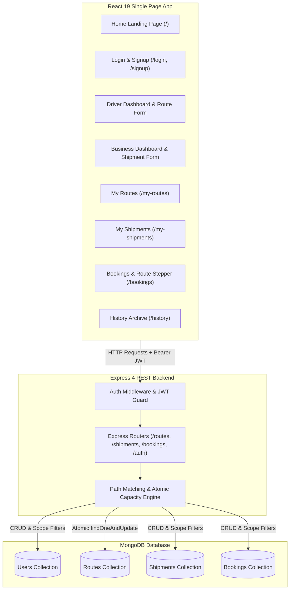
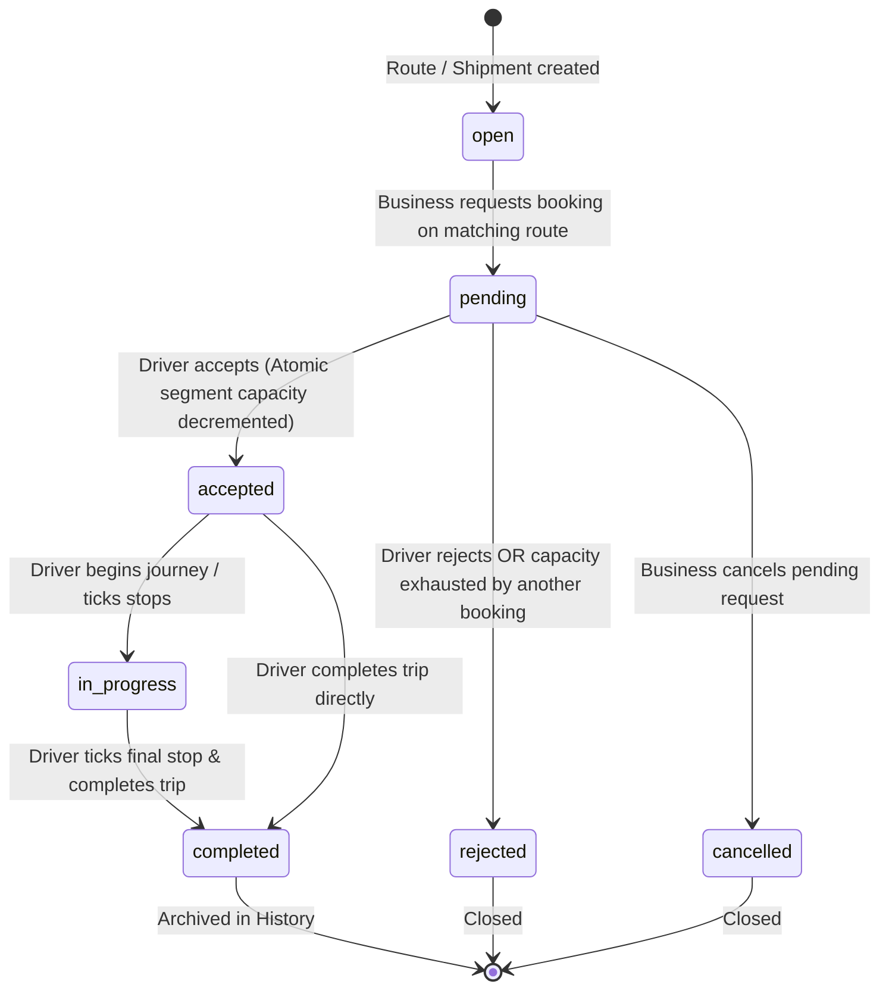

# Trucksy

Modern, multi-tenant logistics and freight-capacity coordination platform engineered on the MERN stack (MongoDB, Express, React 19, Node.js) with Tailwind CSS v4.

---

## Table of Contents
1. [Overview & Problem Statement](#overview--problem-statement)
2. [Old Trucksy vs. New Trucksy: Detailed Comparison](#old-trucksy-vs-new-trucksy-detailed-comparison)
3. [Key Architecture & Core Features](#key-architecture--core-features)
4. [System Architecture Diagram](#system-architecture-diagram)
5. [Booking & Lifecycle State Machine](#booking--lifecycle-state-machine)
6. [Design System & UI Components](#design-system--ui-components)
7. [API Reference](#api-reference)
8. [Local Development Setup](#local-development-setup)
9. [Environment Variables](#environment-variables)
10. [Testing Suite](#testing-suite)
11. [Deployment Guide](#deployment-guide)

---

## Overview & Problem Statement

Commercial freight operators regularly run routes with unused payload capacity and unutilized cubic volume across different segments of their journey. Concurrently, businesses and manufacturers struggle to secure affordable, on-demand shipping for partial loads without paying full-vehicle freight rates.

**Trucksy** solves this inefficiency by matching open cargo shipments to scheduled truck routes based on:
- Date alignment (departure dates and estimated arrival dates)
- Normalized spatial path topology (origin, sequential intermediate stops, and final destination)
- Multi-segment atomic capacity checking (verifying weight and cubic volume availability along every hop)

---

## Old Trucksy vs. New Trucksy: Detailed Comparison

| Feature / Domain | Old Trucksy (Legacy / Prototype) | New Trucksy (Current Release) |
|---|---|---|
| **Styling & CSS Architecture** | Legacy CSS files (`App.css`, un-scoped classes in `index.css`), scattered inline `style={{ }}` attributes, inconsistent paddings and fonts. | **Tailwind CSS v4** engine (`@tailwindcss/vite`), custom design system with `@layer base`, Inter typography, responsive utility classes, zero inline layout styles, `App.css` deleted. |
| **Active vs. Completed Isolation** | Completed trips and delivered shipments lingered in active views ("My Routes" and "My Shipments") with active Delete buttons. | **Scope Filtering**: Active views show only active items (`open`/`in_progress` routes, `open`/`booked` shipments). Completed trips live exclusively in `/history`. |
| **Backend Scope Endpoints** | `GET /routes/mine` and `GET /shipments/mine` returned every document unconditionally. | `GET /routes/mine` and `GET /shipments/mine` default to active-only scope; optional `?scope=all` query parameter available. |
| **Deletion Protection** | Deletion did not check live booking dependencies, allowing accidental deletion of booked routes/shipments. | **409 Conflict Protection**: Deletion of routes or shipments is strictly prevented if live bookings exist or status is not `open`. |
| **Dashboard Metrics** | Stats counters counted delivered shipments and completed routes, distorting live capacity numbers. | Dashboard cards, match banners, and counters filter strictly by active states, ignoring completed/delivered items. |
| **Public Visitor Experience** | No dedicated public landing page; visitors were redirected directly to the login form. | Modern **Landing Page (`/`)** with hero headline, platform mission, 3 feature cards, and role onboarding CTAs (auto-redirects logged-in users). |
| **Button States & Duplicate Prevention** | Relied on inconsistent spinners or raw button states susceptible to double-clicking and race conditions. | **Blocked Button Architecture**: On submit, buttons enter disabled state with `pointer-events-none` and `cursor-not-allowed`, preventing duplicate submissions without visual spinners. |
| **Loading Indicators** | Animated SVG spinners (`Spinner.jsx`, button spinners) were scattered across pages. | **No-Spinner Architecture**: All spinners removed; data-fetching pages use clean, minimal status text (`Loading...`). |
| **Component System** | Ad-hoc markup across individual pages with duplicated badge and button code. | **Reusable Component Suite** (`Button`, `Badge`, `Card`, `Alert`, `Input`, `Select`, `EmptyState`, `PageHeader`, `RouteStepper`). |
| **Journey Tracking** | Basic text lists for route stops without visual truck location tracking. | **Live Route Stepper**: Visual timeline showing origin, intermediate stops, truck position indicator, and dropoff milestones. |
| **Mobile Responsiveness** | Fixed desktop-oriented tables and navigation bars that overflowed on mobile viewports. | **Fully Responsive**: Verified at 375px, 768px, and 1280px with collapsible mobile hamburger navbar and 1-column form layouts. |
| **Seeder & Demo Data** | Hardcoded mock database seeder (`seed.js`) with demo accounts. | Seeder script deleted; database cleaned of demo accounts for production integrity. |
| **Code Documentation** | Mixed development comments and legacy notes throughout source files. | **Zero Comments**: Strict comment removal across all backend and frontend production source files. |

---

## Key Architecture & Core Features

### 1. Spatial Route & Segment Matching
Evaluates whether a shipment's pickup and dropoff points exist in forward topological order along a driver's route path:
`origin -> stop_1 -> stop_2 -> ... -> destination`
Validates that:
- `pickup_index < dropoff_index`
- Every intermediate segment between pickup and dropoff has sufficient remaining weight capacity (`capacity >= weight`) and volume space (`space >= volume`).
- Departure dates match, and city names are normalized (case-insensitive and trimmed).

### 2. Atomic Capacity Reservation
Booking acceptances utilize single-operation MongoDB find-and-update queries (`findOneAndUpdate` with `$inc`) to atomically decrement capacity across each hopped segment. If another concurrent booking consumes the remaining capacity first, the second operation immediately fails and transitions to `rejected`, preventing overbooking.

### 3. One-Active-Trip Rule
A driver is permitted only one active route (`open` or `in_progress`) at any given time. Attempting to create an additional route while one is active returns HTTP `409 Conflict`. A driver may post a new route only after completing or deleting the active one.

### 4. Route Departure and End Dates
Every route requires both a `date` (departure) and `endDate` (estimated arrival at final destination), with `endDate >= date`. Shippers can see the driver's estimated reach date before booking and throughout active shipment transit.

### 5. Sequential Route Execution
Drivers progress through intermediate stops in strict order. Marking a stop complete updates the truck's real-time position on the `RouteStepper` and marks deliveries destined for that stop as `delivered`.

### 6. Non-Destructive Trip Archival
Completed routes, delivered shipments, and historical bookings are never deleted from the database. When a trip completes:
- The route status transitions to `completed`.
- Accepted bookings transition to `completed`.
- Shipments transition to `delivered`.
- The items disappear from active lists (`My Routes`, `My Shipments`, `Bookings`) and appear in `History`.

---

## System Architecture Diagram



---

## Booking & Lifecycle State Machine



---

## Design System & UI Components

The application follows a clean, modern aesthetic:
- **Palette**: Slate-50 background (`#f8fafc`), pure white cards (`#ffffff`), subtle borders (`#e2e8f0`), primary Indigo accents (`#4f46e5` / `#4338ca`).
- **Typography**: Inter font family, high contrast scales, semantic HTML structure.
- **Responsiveness**: Fluid layout from mobile phones (375px) to tablets (768px) and desktop displays (1280px+).

### Component Suite (`frontend/src/components/`)
1. **`Button`**: Supports `primary`, `secondary`, `danger`, `success`, and `outlineDanger` variants. Features automatic click blocking via `disabled:pointer-events-none` when `loading` or `disabled` is active.
2. **`Badge`**: Pill badges categorized by state:
   - Amber: `open`, `pending`
   - Blue: `in_progress`, `accepted`
   - Green: `completed`, `delivered`
   - Red / Gray: `rejected`, `cancelled`
   - Indigo: `driver`
   - Purple: `business`
3. **`Card`**: Modular composition with `Card`, `CardHeader`, `CardBody`, and `CardFooter`.
4. **`Alert`**: Contextual message banners (`error`, `success`, `info`, `warning`) with optional `onRetry` handler.
5. **`EmptyState`**: Friendly zero-data screens with icon, heading, descriptive copy, and call-to-action button.
6. **`Input` & `Select`**: Form controls with automatic IDs, required field indicators, error states, helper text, and focus rings.
7. **`PageHeader`**: Standardized page title, subtitle, and action slot.
8. **`RouteStepper`**: Visual progress tracker showing route stops, real-time truck position, and dropoff completion badges.
9. **`Navbar`**: Responsive top navigation with active tab pill indicators, user chip with role badge, logout action, and mobile hamburger menu.

---

## API Reference

All protected endpoints require an `Authorization: Bearer <token>` header.

### Authentication Endpoints
| Method | Endpoint | Access | Description |
|---|---|---|---|
| `POST` | `/api/auth/signup` | Public | Registers a new driver or business account |
| `POST` | `/api/auth/login` | Public | Authenticates credentials and returns JWT token |
| `GET` | `/api/auth/me` | Authenticated | Returns profile of currently authenticated user |

### Route Endpoints
| Method | Endpoint | Access | Description |
|---|---|---|---|
| `POST` | `/api/routes` | Driver | Creates route with `date`, `endDate`, `capacity`, `space`. Enforces one-active-trip rule (HTTP 409 if active trip exists). |
| `GET` | `/api/routes/mine` | Driver | Lists driver's active routes by default. Use `?scope=all` to include completed routes. |
| `DELETE` | `/api/routes/:id` | Driver | Deletes route. Blocked with HTTP 409 if not `open` or if live bookings exist. |
| `POST` | `/api/routes/:id/stops/:index/complete` | Driver | Marks intermediate stop complete in sequential order; flags dropoffs as delivered. |
| `POST` | `/api/routes/:id/complete` | Driver | Completes entire route, marking accepted bookings `completed` and shipments `delivered`. |

### Shipment Endpoints
| Method | Endpoint | Access | Description |
|---|---|---|---|
| `POST` | `/api/shipments` | Business | Creates shipment with `from`, `to`, `date`, `weight`, `space`. |
| `GET` | `/api/shipments/mine` | Business | Lists business's active shipments by default. Use `?scope=all` to include delivered shipments. |
| `DELETE` | `/api/shipments/:id` | Business | Deletes shipment. Blocked with HTTP 409 if status is not `open` or live bookings exist. |

### Matching & Booking Endpoints
| Method | Endpoint | Access | Description |
|---|---|---|---|
| `GET` | `/api/matches` | Business | Finds open routes matching caller's open shipments with remaining segment capacity. |
| `GET` | `/api/matches/summary` | Driver | Returns count of open shipments fitting driver's open route. |
| `POST` | `/api/bookings` | Business | Requests booking on matching route; snapshots cargo load. |
| `GET` | `/api/bookings/mine` | Authenticated | Lists caller's bookings (populated with route, shipment, and counterparty). |
| `PATCH` | `/api/bookings/:id/accept` | Driver | Atomically reserves segment capacity via `Route.findOneAndUpdate`. |
| `PATCH` | `/api/bookings/:id/reject` | Driver | Rejects pending booking request. |
| `PATCH` | `/api/bookings/:id/cancel` | Business | Cancels pending booking request. |
| `GET` | `/api/health` | Public | Health probe returning `{ status: "ok" }`. |

---

## Local Development Setup

### Prerequisites
- Node.js (v20.x or v22.x)
- MongoDB instance (Local community server or MongoDB Atlas URI)

### 1. Installation
Clone the repository and install dependencies:
```bash
# Root and frontend dependencies
npm run build

# Backend dependencies
cd backend
npm install
cd ..
```

### 2. Configure Backend Environment
Create `backend/.env`:
```env
PORT=5000
MONGODB_URI=mongodb://localhost:27017/trucksy
JWT_SECRET=super_secret_jwt_key_at_least_32_characters
JWT_EXPIRES_IN=7d
CLIENT_URL=http://localhost:5173
```

### 3. Configure Frontend Environment
Create `frontend/.env`:
```env
VITE_API_URL=http://localhost:5000/api
```

### 4. Running the Development Servers
In two separate terminals:

```bash
# Terminal 1: Backend
npm run dev:backend

# Terminal 2: Frontend
npm run dev:frontend
```
- Frontend client will be available at: `http://localhost:5173`
- Backend API will listen on: `http://localhost:5000`

---

## Environment Variables

### Backend (`backend/.env`)
| Variable | Description | Default / Example |
|---|---|---|
| `PORT` | Server listening port | `5000` |
| `MONGODB_URI` | MongoDB connection URI string | `mongodb://localhost:27017/trucksy` |
| `JWT_SECRET` | Secret key used for signing JWT tokens | `your_secret_key` |
| `JWT_EXPIRES_IN` | Token expiration duration | `7d` |
| `CLIENT_URL` | Allowed client origin for CORS validation | `http://localhost:5173` |

### Frontend (`frontend/.env`)
| Variable | Description | Default / Example |
|---|---|---|
| `VITE_API_URL` | Base API URL prefix | `http://localhost:5000/api` |

---

## Testing Suite

All tests execute with Node's native test runner (`node:test`) without third-party test framework overhead:

```bash
# Run all backend tests
npm test
```

### Tested Capabilities
- **Path Topology & Order**: Validates forward path ordering and rejects reverse journeys.
- **Segment Capacity Logic**: Checks multi-segment capacity constraints along each leg.
- **Date Matching**: Rejects routes with mismatching departure dates.
- **Atomic Concurrency Protection**: Validates that concurrent acceptances exhaust capacity and reject subsequent requests with HTTP 409.
- **Active Scope Filtering**: Tests pure functions (`getRouteMineFilter`, `getShipmentMineFilter`, `isRouteActive`, `isShipmentActive`, `filterActiveRoutes`, `filterActiveShipments`) ensuring completed records are isolated from active views.

---

## Deployment Guide

### Backend on Render
1. Create a **New Web Service** connected to your repository.
2. Set **Root Directory** to `backend`.
3. Set **Build Command** to `npm install`.
4. Set **Start Command** to `node src/index.js`.
5. Set environment variables: `MONGODB_URI`, `JWT_SECRET`, `JWT_EXPIRES_IN`, `CLIENT_URL`.

### Frontend on Vercel
1. Import the repository into Vercel.
2. Set **Root Directory** to `frontend`.
3. Framework preset: **Vite**.
4. Set environment variable: `VITE_API_URL=https://<your-render-backend>.onrender.com/api`.
5. The included `frontend/vercel.json` ensures client-side routing rewrites all requests to `index.html`.
