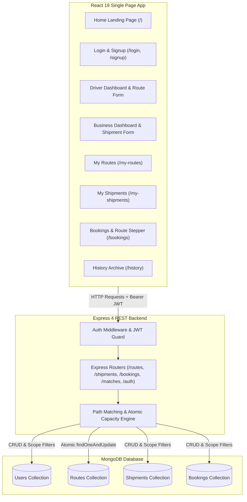
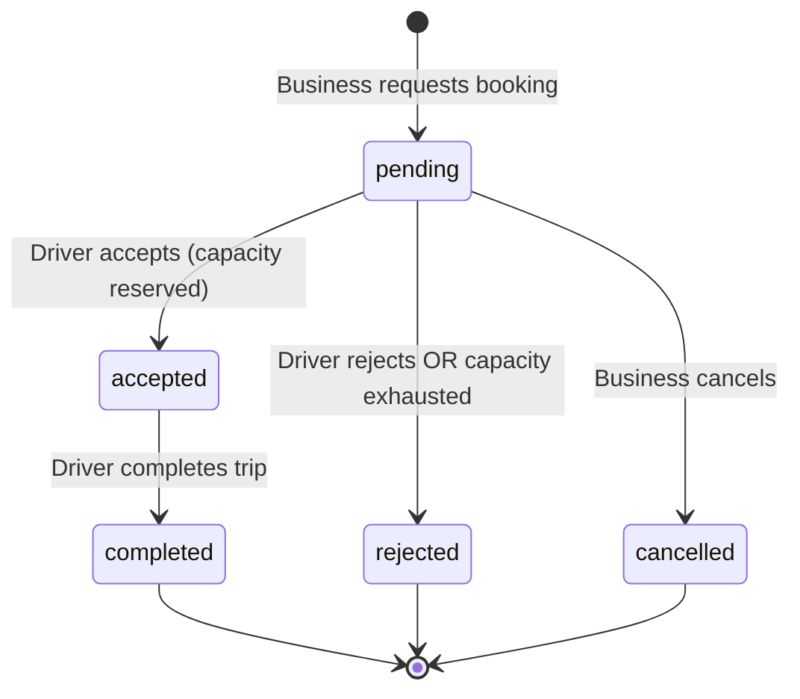

# Trucksy

Logistics and freight-capacity coordination platform engineered on the MERN stack with Tailwind CSS v4.

---

## Table of Contents
1. [Live Demo](#live-demo)
2. [Problem Statement](#problem-statement)
3. [Target Users](#target-users)
4. [Solution](#solution)
5. [Key Features](#key-features)
6. [Screenshots](#screenshots)
7. [Tech Stack](#tech-stack)
8. [Architecture](#architecture)
9. [Security](#security)
10. [API Reference](#api-reference)
11. [Local Setup](#local-setup)
12. [Environment Variables](#environment-variables)
13. [Testing](#testing)
14. [Deployment](#deployment)
15. [Project History](#project-history)
16. [Known Limitations](#known-limitations)

---

## Live Demo

- **Frontend Application**: https://trucksy-v2-frontend-1ag2q215j-ihogs-projects.vercel.app/
- **Backend Health Check**: https://trucksy-v2-backend-jg3mfr5hn-ihogs-projects.vercel.app/api/health

### Demo Credentials
These accounts were created through the standard signup page on the live deployment:
- **Driver Account**: Email: `charan@email.com`, Password: `12345678`
- **Business Account**: Email: `sai@email.com`, Password: `12345678`

### Try the Main Workflow
1. Log in as the driver and post a route with intermediate stops, a departure date, an arrival end date, and available payload capacity.
2. Log in as the business and post a shipment on the same date whose pickup and dropoff points fit within the driver's route stops.
3. Open **Bookings** as the business and click **Book Now** on the matching route.
4. Log in as the driver and accept the pending booking request.
5. In the active trip view, tick the route stops in sequential order.
6. Click **Complete Trip** once all intermediate stops are ticked.
7. Open **History** as both the driver and the business to confirm the completed trip and delivered shipment are archived.

### See the Capacity Protection
1. Log in as a driver and post a route with `1000` kg capacity.
2. Log in as two separate business accounts and post shipments for `700` kg and `600` kg along the same path and date.
3. Submit booking requests from both business accounts.
4. Log in as the driver and accept the first booking (`700` kg).
5. Attempt to accept the second booking (`600` kg); the operation fails with HTTP `409 Conflict` because the required route segment capacity is exhausted.

---

## Problem Statement

Commercial freight operators regularly run scheduled routes with unutilized payload capacity and empty cargo volume across segments of their journey. Concurrently, small and medium enterprises struggle to secure affordable, on-demand shipping for partial loads without paying full-vehicle freight rates.

---

## Target Users

- **Drivers**: Owner-operators and commercial freight drivers running scheduled routes with spare truck weight capacity and cubic space.
- **Businesses**: Small and medium-sized businesses (SMBs), manufacturers, and distributors requiring partial-load or scheduled freight transport along existing driver routes.

---

## Solution

Trucksy connects freight supply with shipping demand through:
- **Topological Route Matching**: Server-side algorithms match shipments to routes based on departure date alignment, ordered stop paths, and available capacity across every hop.
- **Atomic Capacity Reservations**: Single-operation database updates guarantee capacity allocation, preventing double-booking and race conditions.
- **Trip Progress Tracking**: Sequential stop checklists for drivers and automated 20-second background polling for businesses provide synchronized shipment tracking, archiving completed journeys non-destructively in history.

---

## Key Features

- **Role-Based Authentication**: Dedicated registration and login flows for Driver and Business roles with JSON Web Token session management.
- **Routes with Stops and Dates**: Drivers publish journeys with departure dates, estimated arrival dates, maximum payload weight, volume space, and up to 10 ordered intermediate stops.
- **Shipments**: Businesses publish cargo requirements specifying pickup and dropoff locations, shipment date, weight, and volume.
- **Server-Side Matching**: Topological path inspection and multi-segment capacity calculations executed on the server.
- **Atomic Capacity Reservation**: Atomic segment capacity decrements via MongoDB `findOneAndUpdate` with concurrency protection.
- **Driver Stop Checklist & Business Trip Tracking**: Ordered stop check-offs by the driver and synchronized tracking by the business via 20-second periodic polling (not real-time).
- **History Archival**: Non-destructive lifecycle transitions archiving completed trips and delivered shipments for both roles.
- **One Active Trip Rule**: Server-enforced rule restricting drivers to a single active route (`open` or `in_progress`) at any given time.
- **Responsive Tailwind CSS Interface**: Interface built with reusable UI components (`Button`, `Badge`, `Card`, `Alert`, `Input`, `Select`, `EmptyState`, `PageHeader`, `RouteStepper`), mobile hamburger navigation, status badges, and a visual route stepper tracking truck position.

---

## Tech Stack

- **Frontend**: React 19, Vite, Tailwind CSS v4, Axios, React Router v7
- **Backend**: Node.js, Express 4, Mongoose 8 (MongoDB ODM)
- **Authentication & Security**: JSON Web Tokens (`jsonwebtoken`), `bcryptjs`, `cors`, `dotenv`
- **Testing**: Node.js native test runner (`node:test`)
- **Hosting / Infrastructure**: MongoDB Atlas (Database), Vercel (Frontend & Serverless deployment target)

---

### System Flowchart



### Backend Modules

- **`src/models/`**: Mongoose schemas defining data structures, validations, and compound indexes:
  - `User.js`: User credentials, roles (`driver` / `business`), and password hashing methods.
  - `Route.js`: Driver routes, normalized path keys, segment capacity tracking, and stop completion state.
  - `Shipment.js`: Business cargo requests with normalized origin/destination keys and lifecycle states.
  - `Booking.js`: Relational link binding routes, shipments, segment indices, snapshot loads, and statuses.
- **`src/routes/`**: Express endpoint handlers validating inputs, applying ownership guards, and executing domain actions:
  - `authRoutes.js`: User registration, authentication, and profile retrieval.
  - `routeRoutes.js`: Route creation, retrieval, deletion, stop completion, and finalization.
  - `shipmentRoutes.js`: Shipment posting, retrieval, and deletion.
  - `matchRoutes.js`: Server-side matching queries for businesses and drivers.
  - `bookingRoutes.js`: Booking creation, retrieval, acceptance with atomic capacity check, rejection, and cancellation.
- **`src/middleware/`**:
  - `auth.js`: JWT verification (`authenticate`) and role-based access checks (`requireRole`).
  - `errorHandler.js`: Centralized error handler formatting Mongoose errors, CastErrors, and HTTP status codes.
- **`src/utils/`**: Pure functions for core logic:
  - `matching.js`: Forward topological path matching and available capacity verification.
  - `capacity.js`: Generates atomic `$inc` updates and segment query filters for MongoDB operations.
  - `scope.js`: Returns query filters separating active items from archived history.
  - `normalise.js`: Trims, collapses whitespace, and lowercases city names for reliable matching.
  - `token.js`: Generates and verifies JSON Web Tokens.

### Booking Lifecycle State Machine



### Route Lifecycle Statuses

| Status | Description |
|---|---|
| `open` | Route is posted and available for bookings; departure has not started. |
| `in_progress` | Driver has checked off at least one intermediate stop along the journey. |
| `completed` | All intermediate stops are checked off and the trip is finalized by the driver. |
| `cancelled` | Route was cancelled or withdrawn. |

### Shipment Lifecycle Statuses

| Status | Description |
|---|---|
| `open` | Shipment is posted and waiting to be matched with a route. |
| `booked` | A driver accepted a booking for this shipment; capacity is reserved. |
| `delivered` | The driver completed the trip or checked off the delivery dropoff stop. |
| `cancelled` | Shipment was cancelled or withdrawn. |

---

## Security

- **Password Hashing**: User passwords are encrypted using `bcryptjs` (10 salt rounds) before persistence and stripped from JSON output by default.
- **Stateless JWT Authentication**: Protected endpoints require a valid JSON Web Token passed via the `Authorization: Bearer <token>` header.
- **Role & Ownership Authorization**: Server middleware enforces role permissions (`driver` vs. `business`) and verifies document ownership before mutation or deletion.
- **Input Validation**: Centralized field checks verify mandatory parameters and reject non-string inputs where strings are expected.
- **ObjectId Validation**: Mongoose validates MongoDB ObjectIds, preventing application crashes from malformed identifiers.
- **Environment Isolation**: Database connection strings, JWT secrets, and port configurations are loaded strictly from environment variables.
- **CORS Restriction**: Cross-Origin Resource Sharing is configured to allow requests only from trusted client origins.

---

## API Reference

All protected endpoints require an `Authorization: Bearer <token>` header.

### Authentication Endpoints
| Method | Endpoint | Access | Description |
|---|---|---|---|
| `POST` | `/api/auth/signup` | Public | Registers a new user account (`driver` or `business`). |
| `POST` | `/api/auth/login` | Public | Authenticates credentials and returns a signed JWT. |
| `GET` | `/api/auth/me` | Authenticated | Returns the profile of the authenticated user. |

### Route Endpoints
| Method | Endpoint | Access | Description |
|---|---|---|---|
| `POST` | `/api/routes` | Driver | Creates a route (`date`, `endDate`, `capacity`, `space`, `stops`). Enforces one-active-trip rule. |
| `GET` | `/api/routes/mine` | Driver | Lists driver routes. Defaults to active items; supports `?scope=all`. |
| `DELETE` | `/api/routes/:id` | Driver (Owner) | Deletes an open route. Blocked with HTTP 409 if status is not `open` or if active bookings exist. |
| `POST` | `/api/routes/:routeId/stops/:index/complete` | Driver (Owner) | Marks an intermediate stop complete in sequential order; updates delivery milestone flags. |
| `POST` | `/api/routes/:routeId/complete` | Driver (Owner) | Completes the entire trip, marking accepted bookings `completed` and shipments `delivered`. |

### Shipment Endpoints
| Method | Endpoint | Access | Description |
|---|---|---|---|
| `POST` | `/api/shipments` | Business | Posts a shipment (`from`, `to`, `date`, `weight`, `space`). |
| `GET` | `/api/shipments/mine` | Business | Lists business shipments. Defaults to active items; supports `?scope=all`. |
| `DELETE` | `/api/shipments/:id` | Business (Owner) | Deletes an open shipment. Blocked with HTTP 409 if status is not `open` or if active bookings exist. |

### Matching & Booking Endpoints
| Method | Endpoint | Access | Description |
|---|---|---|---|
| `GET` | `/api/matches` | Business | Returns open routes accommodating the caller's open shipments with sufficient capacity. |
| `GET` | `/api/matches/summary` | Driver | Returns total count of open shipments fitting the driver's open route. |
| `POST` | `/api/bookings` | Business (Owner) | Submits a booking request on a matching route; snapshots cargo parameters. |
| `GET` | `/api/bookings/mine` | Authenticated | Returns bookings for the caller populated with route, shipment, driver, and business details. |
| `PATCH` | `/api/bookings/:id/accept` | Driver (Owner) | Atomically decrements route segment capacity via `findOneAndUpdate`. Rejects with 409 if capacity is exhausted. |
| `PATCH` | `/api/bookings/:id/reject` | Driver (Owner) | Rejects a pending booking request. |
| `PATCH` | `/api/bookings/:id/cancel` | Business (Owner) | Cancels a pending booking request. |

### Health Endpoint
| Method | Endpoint | Access | Description |
|---|---|---|---|
| `GET` | `/api/health` | Public | Returns health status `{ status: "ok" }` (also responds at `/health`). |

---

## Local Setup

### 1. Clone Repository
```bash
git clone https://github.com/Mds-1234/Trucksy_V2
cd Trucksy
```

### 2. Install Dependencies
```bash
# Install backend dependencies
cd backend
npm install

# Install frontend dependencies
cd ../frontend
npm install

cd ..
```

### 3. Configure Environment Files
Copy the example environment files:
```bash
# In backend directory
cp backend/.env.example backend/.env

# In frontend directory
cp frontend/.env.example frontend/.env
```

### 4. Run Development Servers
Start backend and frontend in separate terminals:

```bash
# Terminal 1: Backend API
cd backend
npm run dev
```

```bash
# Terminal 2: Frontend Client
cd frontend
npm run dev
```

- Frontend runs at: `http://localhost:5173`
- Backend API runs at: `http://localhost:5000`

---

## Environment Variables

### Backend (`backend/.env`)
| Variable | Description | Example / Placeholder |
|---|---|---|
| `PORT` | Port for Express server | `5000` |
| `MONGODB_URI` | MongoDB connection URI string | `mongodb+srv://<user>:<password>@<cluster>.mongodb.net/trucksy` |
| `JWT_SECRET` | Secret key for signing JSON Web Tokens | `your_jwt_secret_key_minimum_32_chars` |
| `JWT_EXPIRES_IN` | Token expiration duration | `7d` |
| `CLIENT_URL` | Allowed origin or comma-separated list of origins for CORS headers | `https://<frontend-url>.vercel.app,http://localhost:5173` |

### Frontend (`frontend/.env`)
| Variable | Description | Example / Placeholder |
|---|---|---|
| `VITE_API_URL` | Base API URL prefix | `http://localhost:5000/api` |

---

## Testing

The test suite utilizes Node's native test runner (`node:test`) and asserts business logic without external testing frameworks.

### Covered Logic
- **Topological Path Matching (`src/tests/matching.test.js`)**: Validates forward path ordering, intermediate stop traversal, and rejection of reverse routes.
- **Segment Capacity Verification (`src/tests/matching.test.js`)**: Verifies multi-segment remaining weight and space checks along traversed hops.
- **Date Matching & City Normalization (`src/tests/matching.test.js`)**: Tests departure date alignment and case-insensitive city text comparisons.
- **Route Constraints (`src/tests/routes.test.js`)**: Verifies required arrival dates (`endDate`) and ensures `endDate >= date`.
- **Active Scope Filters (`src/tests/scope.test.js`)**: Validates pure functions isolating active items from completed history records.
- **Atomic Capacity Construction (`src/tests/capacity.test.js`)**: Tests pure filter and `$inc` query construction for multi-segment capacity decrements.

### Running Offline Tests
All unit and pure function tests execute completely offline without requiring a database connection:
```bash
npm test
```

### Running Database Integration Tests
The concurrent atomic capacity test in `backend/src/tests/capacity.test.js` tests MongoDB atomic query execution and is skipped by default. To execute it against a live test database:
```bash
MONGODB_URI_TEST="mongodb://localhost:27017/trucksy_test" npm test
```

---

## Deployment

The application is architected to deploy with MongoDB Atlas and Vercel.

### 1. Database: MongoDB Atlas
1. Create a MongoDB Atlas cluster.
2. In **Network Access**, allow access from anywhere (`0.0.0.0/0`) to allow serverless connections.
3. In **Database Access**, create a database user and obtain the connection URI string.

### 2. Frontend: Vercel
1. Create a new Vercel project pointing to the repository.
2. Set the **Root Directory** to `frontend`.
3. Framework Preset: **Vite**.
4. Configure Environment Variable:
   - `VITE_API_URL`: URL of the deployed backend API (e.g., `https://<backend-url>/api`).
5. Client-side routing is handled by `frontend/vercel.json`, which rewrites all paths to `index.html`.

### 3. Backend: Vercel Serverless Function
1. Create a new Vercel project pointing to the repository.
2. Set the **Root Directory** to `backend`. The serverless function handler is routed through `backend/api/index.js` with all requests directed to `/api` via `backend/vercel.json`.
3. Configure Environment Variables in the Vercel project settings:
   - `MONGODB_URI`: MongoDB Atlas connection string with `0.0.0.0/0` access allowed.
   - `JWT_SECRET`: Secret key for JWT signing (minimum 32 characters).
   - `JWT_EXPIRES_IN`: `7d`
   - `CLIENT_URL`: Comma-separated list of allowed frontend origins (e.g., `https://<frontend-url>.vercel.app,http://localhost:5173`).
   - `NODE_ENV`: `production`
4. **Deployment Order**:
   - Deploy the backend project first to obtain the backend URL.
   - Deploy the frontend project with `VITE_API_URL=https://<backend-url>.vercel.app/api`.
   - Update `CLIENT_URL` in the backend environment variables with the production frontend URL and redeploy the backend.
5. Disable **Vercel Deployment Protection** in project settings so evaluators can access the live endpoints directly without requiring a Vercel team login.

---

## Project History

Trucksy began as a React + Vite + Firebase (Firestore and Firebase Authentication) prototype from a previous term, with matching logic, capacity calculations, and status transitions executing directly in the client browser. For this end-term milestone, the application was re-architected into a MERN platform with a dedicated Express API, server-side JWT authentication, server-enforced matching, atomic booking with concurrency protection, explicit lifecycle state machines, and a redesigned responsive Tailwind CSS interface.

Original version: `https://github.com/Mds-1234/Trucksy`

### Architecture Comparison

| Area | Original Version (Firebase Prototype) | Current Version (MERN Architecture) |
|---|---|---|
| **Where Logic Runs** | Client-side in browser (React components downloaded all database collections and computed matches) | Server-side in Node.js / Express (pure algorithms and targeted database queries) |
| **Authentication** | Firebase Auth client SDK | Custom JSON Web Tokens (JWT) with `bcryptjs` password hashing |
| **Data Store** | Google Cloud Firestore (schemaless client collections) | MongoDB with structured Mongoose models, compound indexing, and schema validations |
| **Capacity Handling** | Client-side string parsing of `"A ➔ B"` route labels | Atomic server-side `$inc` updates via `findOneAndUpdate`, preventing overbooking |
| **Authorization** | Client-side route guards without server enforcement | Server-side JWT middleware (`authenticate`), role checks (`requireRole`), and document ownership validation |
| **Trip History** | Destructive deletion of routes and shipments from Firestore upon trip completion | Non-destructive lifecycle status progression (`completed`, `delivered`) preserved in `/history` |
| **User Interface** | Basic custom CSS with scattered inline styles | Tailwind CSS v4 design system with reusable component set and responsive layouts |

---

## Known Limitations

- **Polling instead of WebSockets**: Trip progress and booking updates synchronize via 20-second background polling rather than real-time WebSockets.
- **Normalized City Text Matching**: Route stop and shipment location matching relies on normalized text strings (trimmed, lowercased) rather than geographic GPS coordinates or map-based waypoint routing.
- **One Active Trip Rule**: Drivers can only have one active route (`open` or `in_progress`) at any given time.
- **Serverless Cold Starts**: When deployed in serverless environments, initial requests after inactivity may experience brief cold-start latency.
- **No Payment Processing**: Financial transactions and escrow payment gateway integrations are not implemented.
